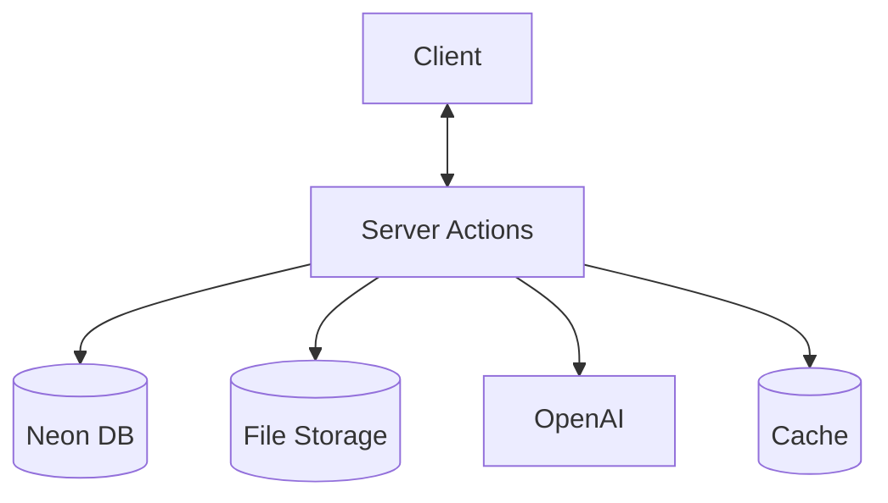
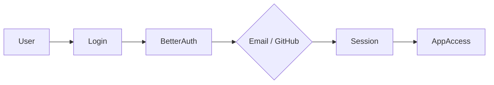
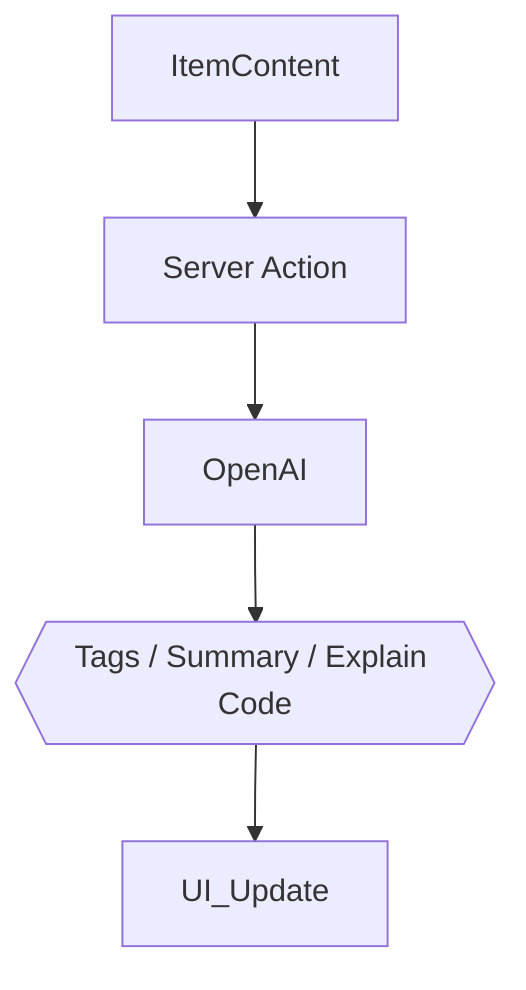

# DevStash Project Specifications

🚀 **Centralized Developer Knowledge Hub** for code snippets, AI prompts, docs, commands & more.

---

## 📌 Problem (Core Idea)

Developers keep their essentials scattered:

- Code snippets in VS Code or Notion
- AI prompts in chats
- Context files buried in projects
- Useful links in bookmarks
- Docs in random folders
- Commands in .txt files
- Project templates in GitHub gists
- Terminal commands in bash history

This creates **context switching, lost knowledge** and **inconsistent workflows**.

➡️ **DevStash provides ONE searchable, AI‑enhanced hub for all dev knowledge & resources.**

---

## 🧑‍💻 Users

| Persona                    | Needs                                     |
| -------------------------- | ----------------------------------------- |
| Everyday Developer         | Quick access to snippets, commands, links |
| AI‑First Developer         | Store prompts, workflows, contexts        |
| Content Creator / Educator | Save learning notes, reusable code        |
| Full‑Stack Builder         | Patterns, boilerplates, API references    |

---

## ✨ Core Features

### A) Items & System Item Types

Items can belong to one of the following built‑in types:

- Snippet
- Prompt
- Note
- Command
- File
- Image
- URL

Custom types allowed for Pro users.

### B) Collections

Organize items—mixed item types allowed.

Examples:

- React Patterns
- Context Files
- Python Snippets

### C) Search

Full‑text search across:

- Content
- Tags
- Titles
- Types

### D) Authentication

- Email + Password
- GitHub OAuth

### E) Additional Features

- Favorites & pinned items
- Recently used
- Import from files
- Markdown editor for text items
- File uploads (images, docs, templates)
- Export (JSON / ZIP)

### F) AI Superpowers

- Auto‑tagging
- AI summaries
- Explain Code
- Prompt optimization

> AI powered by **OpenAI gpt-5-nano**

---

## 🗄️ Data Model

Prisma schema lives in `prisma/schema.prisma` (source of truth). Main entities:

- **User** — `isPro` flag, Stripe ids; owns everything below
- **Item** — `contentType` (TEXT / FILE / URL), belongs to one ItemType and optionally one Collection
- **ItemType** — system types (`userId` null) and Pro custom types
- **Collection** — mixed item types allowed
- **Tag** / **ItemTag** — per-user tags, many-to-many with items
- **Session / Account / Verification** — Better Auth tables

Postgres treats nulls as distinct, so system-type name uniqueness needs a partial unique index added manually in the migration SQL.

---

## 🧱 Tech Stack

| Category     | Choice                       |
| ------------ | ---------------------------- |
| Framework    | **Next.js (React 19)**       |
| Language     | TypeScript                   |
| Database     | Neon PostgreSQL + Prisma ORM |
| Caching      | Redis (optional)             |
| File Storage | Cloudflare R2                |
| CSS/UI       | Tailwind CSS v4 + ShadCN     |
| Auth         | Better Auth (email + GitHub) |
| AI           | OpenAI gpt-5-nano            |
| Deployment   | Vercel (likely)              |
| Monitoring   | Sentry (later)               |

---

## 💰 Monetization

| Plan | Price           | Limits                  | Features                                        |
| ---- | --------------- | ----------------------- | ----------------------------------------------- |
| Free | $0              | 50 items, 3 collections | Basic search, image uploads, no AI              |
| Pro  | $8/mo or $72/yr | Unlimited               | File uploads, custom types, AI features, export |

> Stripe for subscriptions + webhooks for syncing

---

## 🎨 UI / UX

- Dark mode first
- Minimal, developer‑friendly UI
- Syntax highlighting for code
- Inspired by **Notion, Linear, Raycast**

### Layout

- **Collapsible sidebar** with filters & collections
- Main grid/list workspace
- Full‑screen item editor

### Responsive

- Mobile drawer for sidebar
- Touch‑optimized icons and buttons

---

## 🔌 Server Architecture

Mutations and data fetching use **Server Actions** and Server Components. Route handlers are only used where required, such as Better Auth (`/api/auth/*`) and Stripe webhooks.



---

## 🔐 Auth Flow



---

## 🧠 AI Feature Flow



---

## 🗂️ Development Workflow

- **One branch per feature**
- Use **Cursor / Claude Code / ChatGPT** for assistance
- Sentry for runtime monitoring & error tracking
- GitHub Actions (optional for CI)

**Branch examples**:

```
git switch -c feature/setup
```

---

## 🧭 Roadmap

### **MVP**

- Items CRUD
- Collections
- Search
- Basic tags
- Free tier limits

### **Pro Phase**

- AI features
- Custom item types
- File uploads
- Export
- Billing & upgrade flow

### **Future Enhancements**

- Shared collections
- Team/Org plans
- VS Code extension
- Browser extension
- API + CLI tool

---

## 📌 Status

- In planning
- Ready for environment setup & UI scaffolding

---

🏗️ **DevStash — Store Smarter. Build Faster.**
